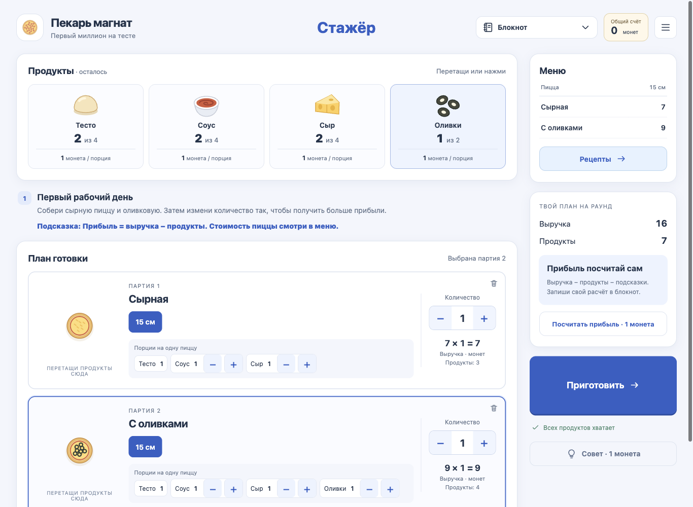

# Пекарь магнат
## Первый миллион на тесте

Экономическая игра на TypeScript для младших школьников. Игрок планирует партии пицц из ограниченной поставки, сам считает прибыль и сравнивает варианты. Без таймера.



## Запуск

Для сборки нужны Node.js 24 и npm.

```bash
npm ci
npm run build
open dist/index.html
```

Для локального сервера: `npm run dev`, затем открыть адрес из терминала.

## Публикация

Адрес игры: [https://aleksander-true.github.io/pizza-economics/](https://aleksander-true.github.io/pizza-economics/).

Каждый push в `master` запускает сборку и публикацию на GitHub Pages. Первичная настройка репозитория и ручной запуск описаны в [инструкции по публикации](docs/github-pages.md).

## Что работает

- 12 рабочих дней. Первые три — простые, с двумя рецептами; отдельного учебного уровня нет.
- Поставки содержат избыток одних продуктов и явное ограничение по другому. Максимальная прибыль не требует пустого склада.
- Остатки лучшей попытки переходят в следующий день и складываются с новой поставкой. В карточках продуктов видно, сколько осталось со вчера и сколько привезли.
- Переиграть можно только последний начатый день, всегда с тем же исходным запасом. После перехода дальше предыдущий день закрыт; худший или равный повтор не меняет сохранённые остатки.
- Бесплатные вводные окна знакомят с правилами и новыми возможностями один раз. Их можно закрыть, писать в блокноте необязательно.
- Дни 1–2: стажировка с пиццами 15 см. День 3: 30 см, рецепты, объяснение площади πR² и блокнот с двумя планами и их прибылью на настоящих ценах.
- Колбаса появляется на 4-м дне, грибы — на 9-м, размер 45 см — на 10-м.
- Текущая должность крупно по центру шапки во время игры; на главной должности не показываются. Стажёр в первые два дня, Помощник с 3-го дня, Младший пекарь с 4-го. Пекарь предусмотрен с 13-го дня, последующие должности пока не открываются.
- «План готовки»: выбор всей карточки кликом или касанием; с клавиатуры — Enter/пробел. Наведение и переход фокуса не меняют выбранную партию. Продукты можно нажимать или перетаскивать на любую часть карточки.
- Одно добавление — одна фактическая порция. На 30 см она закрашивает четверть слоя, на 45 см — одну девятую. В карточке крупные кнопки «+» и «−».
- Автоматическое распознавание рецепта, выручка, стоимость продуктов и проверка запасов. Карточки, расходующие дефицитный продукт, подсвечиваются розовым и показывают, чего не хватает. Числовая прибыль скрыта до приготовления или покупки расчёта.
- Маленькие пиццы имеют большую наценку: при одинаковом расходе четыре маленькие приносят на 2 монеты больше, чем одна 30 см, девять — на 6 больше, чем одна 45 см.
- Расчёт прибыли и каждый совет стоят 1 монету из результата попытки. Общий счёт пополняется только на улучшение личного рекорда.
- Свёрнутый блокнот слева от общего счёта: широкая колонка «Пиццы», узкая числовая «Прибыль», переносы строк, сохранение записей по дням.
- Бургер-меню: уровни и сброс прогресса с нативным подтверждением. Весь логотип возвращает в главное меню через подтверждение.
- Мышь, клавиатура, касания; адаптация для компьютера, планшета и телефона.

Закупки и сборные пиццы отложены по согласованию. Для будущих закупок выбран отдельный бюджет дня. Подробнее: [правила](docs/game-rules.md) и [архитектура](docs/architecture.md).

## Код

В рабочей игре нет сторонних зависимостей. TypeScript и esbuild нужны для разработки и сборки.

| Каталог | Ответственность |
| --- | --- |
| `src/data` | Рецепты, цены, сценарии и карьерные ступени |
| `src/engine` | Чистые расчёты, ограничения, оптимум и звёзды |
| `src/app` | Состояния, команды и последовательность вводных подсказок |
| `src/ui` | HTML, CSS, SVG, нативные диалоги и пользовательский ввод |
| `src/storage` | Проверка и сохранение прогресса в localStorage |

## Смоук-проверка

Используются только смоук-проверки. Модульных тестов и тестового фреймворка нет. `npm run build` проверяет типы и собирает приложение.

1. В новой игре появляется вводное окно дня 1. Доступны только 15 см и два рецепта. Поставка: тесто 6, соус 8, сыр 4, оливки 2.
2. Собрать две сырные и две оливковые: выручка 32, продукты 14. Прибыль автоматически не показывается. После приготовления даже при максимуме остаются 2 порции теста и 4 соуса.
3. Купить расчёт за 1 монету: прибыль 18, результат после подсказки 17. Приготовить: счёт 17. Повторить без подсказки: начисляется только +1. Равный результат больше не пополняет счёт.
4. Перейти в день 2: после лучшего плана дня 1 запас равен 5 / 8 / 7 / 4, с учётом остатков и поставки. День 1 закрыт для повторов. День 2 остаётся стажировкой: доступны только 15 см. На 3-м дне окно повышения до Помощника указывает на рецепты. Для пустой пиццы 30 см одно нажатие на соус добавляет одну порцию и рисует четверть. Четыре порции соуса и сыра дают сырную пиццу ценой 26.
5. День 3: окно указывает на блокнот; две записи без вычислений: «2 с сыром 15 см / 1 с оливками 15 см» — 13 ₵, «1 с сыром 15 см / 2 с оливками 15 см» — 14 ₵. Окно закрывается без ввода. Записи сохраняются после возвращения в меню и перезагрузки. Нетронутый старый автопример обновляется, пользовательские заметки сохраняются.
6. Проверить выбор и перенос на текстовую часть карточки, крупные «+»/«−» касанием, рецепты, меню, подтверждение возврата и сброс.
7. На 10-м дне собрать сырную 45 см: по 9 порций теста, соуса и сыра, цена 57. До 12-го дня должность не выше Младшего пекаря.
8. Проверить старое сохранение v1/v2: деньги и заметки сохраняются. Последний сыгранный день получает новую поставку без выдуманных остатков; старые дни закрыты. Сначала нужно приготовить план этого дня, чтобы появилась основа для переноса дальше.
9. Переиграть последний день с худшей и равной прибылью: деньги и остатки лучшего результата не меняются. Улучшить результат: начисляется только разница, сохраняются остатки нового плана.
10. Вернуться в меню и перезагрузить страницу: начальный запас последнего дня не увеличивается, новая поставка не добавляется повторно. Сброс прогресса очищает и склад.

17 ноября 2026: сборка и расчётный смоук всех 12 дней прошли. В отдельном профиле Яндекс Браузера проверены первые три дня, повышения, порции, ввод и сохранение заметок, награды, мышь, фокус, наведение, перенос касанием, меню и сброс. Проверены экраны 1366 × 1100, 768 × 1024 и 390 × 844. Физический планшет не проверялся.
